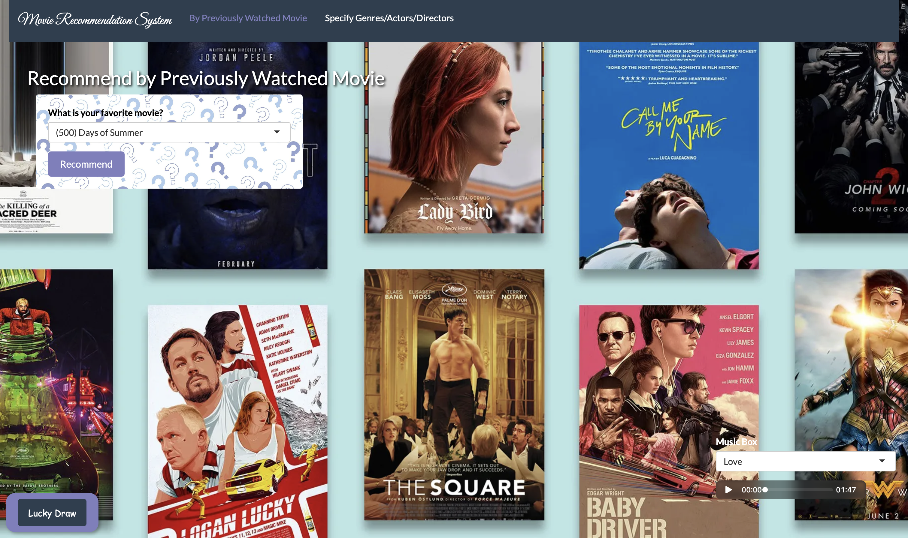
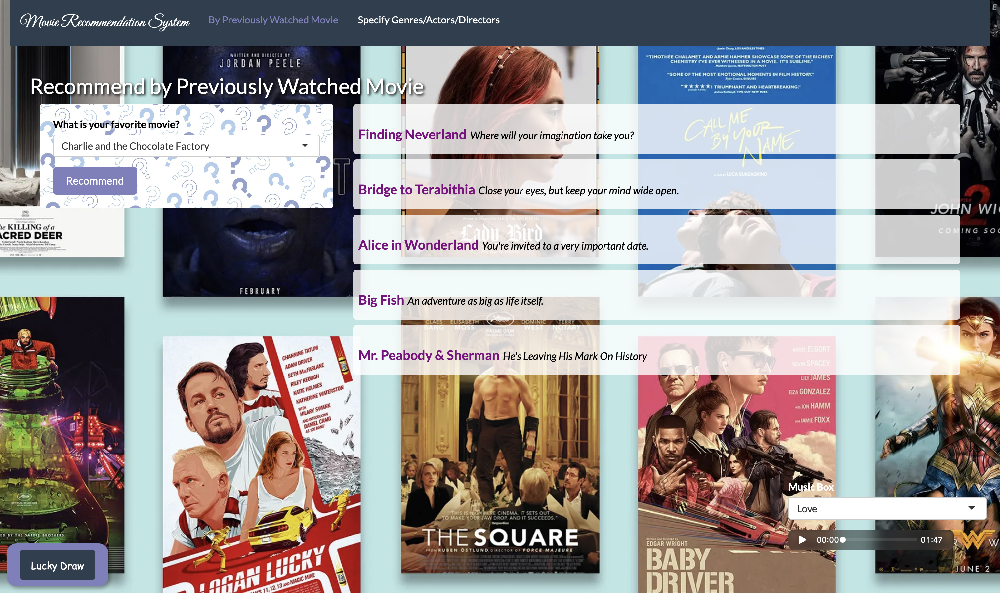
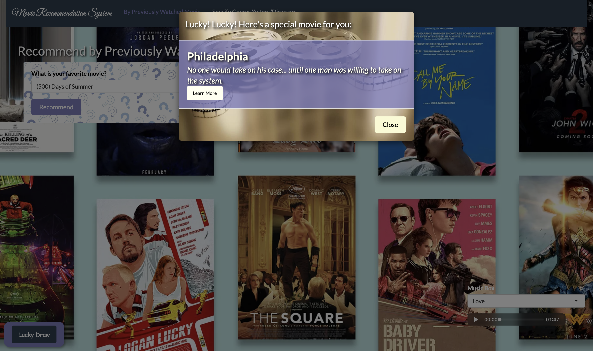
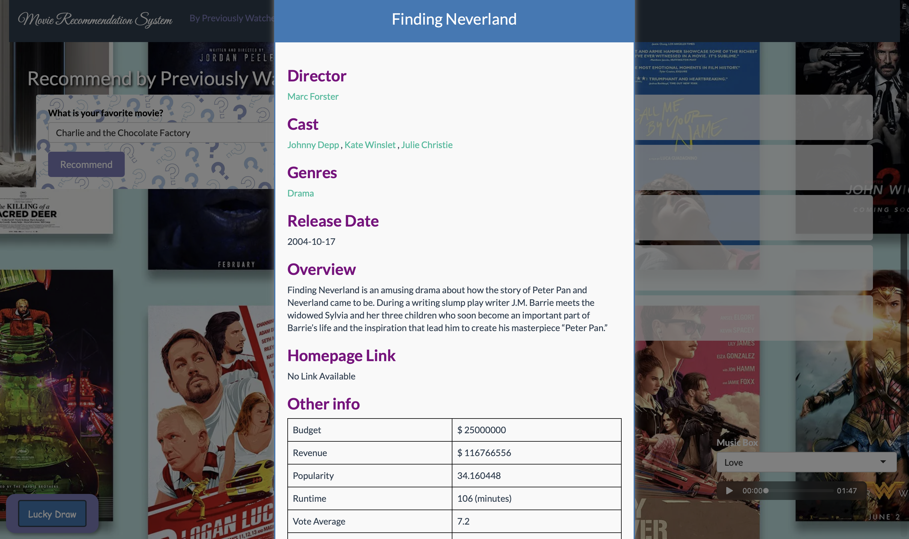

# 🎬 Movie Recommendation App

An interactive R Shiny app for discovering movies through content-based recommendations. Start with a movie you enjoy or choose an actor, genre, and director. Explore the results, try a random pick, and listen to background music while browsing.
**Built with:** R · Shiny · text2vec  
**Methods:** Text preprocessing · TF-IDF · Cosine similarity

<p align="center">
  
</p>

## Explore the app

### 🎞️ Recommend by movie

Select a movie and click **Recommend** to receive five titles with similar metadata. Each result includes the movie title and its tagline, when available. Click a title to view more information.

<p align="center">
  
</p>

### 🎲 Lucky Draw

Click **Lucky Draw** in the lower-left corner to discover a randomly selected movie. The pop-up displays its title and tagline; **Learn More** opens its release date and synopsis.

<p align="center">
  
</p>

### 🎵 Music Box

The **Music Box** in the lower-right corner provides four background music options: **Love**, **Discovery**, **Suspense**, and **Joy**. Select a track and use the audio controls to play or pause it while exploring the app.

## Explore movie details

Click a recommended title to open its detail window. This includes the director, cast, genres, release date, synopsis, and additional information such as runtime, budget, and ratings.

You can also follow connections within the movie collection:

- **Director:** View other movies by the same director.
- **Cast:** Browse movies featuring a selected actor.
- **Genre:** Explore a selection of movies in the same category.
- **Homepage:** Visit the movie’s website, where a link is available.

<p align="center">
  
</p>

## Run locally

The current application is intended to run from **RStudio**.

### 1. Download the repository

Clone the repository or use **Code → Download ZIP** and extract the files. Open `project.Rproj` in RStudio.

### 2. Install dependencies

Run the following in the R console:

```r
install.packages(c(
  "shiny", "shinyWidgets", "shinythemes",
  "superml", "dplyr", "stringr", "proxy",
  "stringdist", "tm", "ggplot2", "tidyverse",
  "tidyr", "purrr", "stringi", "clue", "text2vec"
))
```

### 3. Launch the app

Open `shiny.R` and click **Run App**.

Keep the working directory at the repository root so the app can locate `movies.csv`, `movie_recommend_model.R`, and the `www/` folder.

The recommendation model is built at startup, so the first screen may take some time to load. Some images are hosted externally and require an internet connection.

To end the session, click **Stop** in RStudio. Closing the browser tab alone does not stop the app.

## How it works

### Preparing the movie collection

The model script selects a subset of 1,000 movies using its ranking function. It combines five metadata fields into a text representation of each movie:

- Genres
- Keywords
- Tagline
- Cast
- Director

After text preprocessing, the app converts these representations into **TF-IDF vectors**. This weights terms according to their frequency within each movie’s metadata and across the collection.

### Finding similar movies

For recommendations based on a selected title, the app uses **cosine similarity** to compare that movie’s TF-IDF vector with the rest of the collection. It ranks the results and returns five recommendations, excluding the selected title.

### Matching user preferences

For recommendations based on actor, genre, and director, the app combines the selections into a text query. The current implementation fits TF-IDF to the movie collection together with this query, then calculates query-to-movie similarities to identify the five highest-ranked results.

The approach uses movie metadata rather than users’ viewing histories or ratings.

## Main files

| File or folder | Purpose |
|---|---|
| `shiny.R` | Shiny interface and server logic |
| `movie_recommend_model.R` | Data preparation, text representations, and recommendation functions |
| `movies.csv` | Movie metadata used by the app |
| `project.Rproj` | RStudio project |
| `www/` | Local audio assets |

## Limitations and next steps

The recommendations reflect similarities in movie metadata rather than predictions of individual user ratings. Results are limited to the selected movie collection and depend on the completeness of its metadata.

Potential improvements include:

- Evaluating recommendation quality against a simple baseline.
- Reusing fitted text representations to reduce repeated computation.
- Removing fixed dataset-size assumptions from the recommendation functions.
- Improving handling of missing metadata and ambiguous movie titles.
- Reducing reliance on externally hosted images.

Some movie homepage links may also be outdated.
